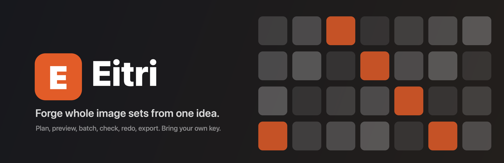

<h1 align="center">Eitri</h1>
<p align="center">
  
  
  
  
</p>

<h3 align="center">Forge whole image sets from one idea.</h3>

<p align="center">
  
</p>

## What it is

Making one AI image is easy. Making three hundred that look like they belong to the same game is
not. You end up in a chat window, pasting prompts one at a time, downloading files by hand,
squinting at which ones came back with a white background, and losing track of what is done.

Eitri is a desktop app that does the whole loop for you. Describe the idea, and it writes a plan:
one shared style and a distinct description for every image. Preview a few, approve the look, then
press Run and watch the grid fill in. Images that come back broken get caught by pixel checks and
retried. Anything you do not like gets a note and a redo. When you are happy, export the set
straight into your project's art folder.

It runs on your machine with your own API keys. There is no server, no account and no telemetry.

## Features

- **Idea to plan** - a planning model writes a style brief, a shared prompt every image ends with, and one specific description per image, streamed in as it is written. Edit anything before you spend a cent.
- **Base library** - keep the generic half of your prompts (framing, style, canvas, background, negatives) as reusable bases. Start from built-in starters, generate a base from a description of the look, or save a project's tuned style. Apply one and the planner only writes the per-image subjects.
- **Import your own list** - bring a CSV or JSON of prompts instead (any file with a `prompt`, `subject` or `description` column), or re-use a plan exported from another project.
- **Preview, then lock** - draw a few, approve the style, then freeze the spec. Every image records a hash of the exact prompt it will send, so nothing drifts mid-run.
- **One style across hundreds of images** - approved images become style references, rotated across the set so a big batch stays consistent without collapsing onto one look.
- **Live batch runs** - a worker pool draws several images at once. Pause, resume, stop, or change how many draw at a time. Every image shows queued, drawing, done, needs review or failed, with its cost.
- **A budget you set** - each project has a dollar cap and the run stops when it is reached. Spend is shown per image, per project, today and all time.
- **Pixel checks for transparent art** - solid backgrounds, see-through holes sealed inside the subject, a subject sitting too small in the frame. A failed image gets one automatic second try, then waits for you.
- **Transparency on any provider** - providers without real alpha draw on a flat chroma backdrop that Eitri keys out, with edge softening and spill removal.
- **Redo with feedback** - write what to change. Eitri edits that exact image when the model supports edits, or redraws it with your note.
- **Keyboard review** - step through results with `A` approve, `R` reject, `F` feedback, arrows to move. Compare every attempt side by side.
- **Export for real projects** - square PNG masters at any size, WebP copies, your own file name pattern, written atomically into the folder your game or site loads from.
- **Safe to stop** - expired keys, quota and billing errors stop the run at once with the image put back in the queue, never retried in a loop. Quit mid-run and the next run resumes exactly there.
- **Desktop notifications** - a long batch can run in the background and tell you when it finishes or stops.

## Providers

| Provider | Image models | Style references | Edits | Native transparency | Plans |
| --- | --- | --- | --- | --- | --- |
| **OpenAI** (reference) | GPT Image 1.5, 1, 1 mini | Yes | Yes | Yes | Yes |
| **Google Gemini** | Gemini 2.5 Flash Image, Imagen 4 (+ Ultra, Fast) | Gemini models | Gemini models | Keyed | Yes |
| **fal.ai** | FLUX 1.1 pro, FLUX dev/schnell, FLUX Kontext, Recraft V3, any fal model id | Kontext | Kontext | Keyed | No |
| **Replicate** | FLUX 1.1 pro, FLUX schnell, FLUX Kontext, Ideogram 3, Recraft V3, any official model | Kontext | Kontext | Keyed | No |
| **Stability AI** | Stable Image Core, Ultra, SD 3.5 Large/Medium | No | No | Keyed | No |
| **OpenAI-compatible** | anything behind `/images/generations` (local servers, gateways) | If supported | If supported | If supported | If supported |

OpenAI is the provider Eitri is used with day to day. The others are implemented from each
provider's public API documentation; if one misbehaves, please [open a provider report](.github/ISSUE_TEMPLATE/provider.yml).
Details and model notes live in [docs/providers.md](docs/providers.md).

## Quick Start

### Requirements

- An API key for at least one provider above.
- macOS 12+, Windows 10+, or a recent Linux desktop with a Secret Service keyring.

### Install

Download a build from Releases, or build from source:

```sh
git clone <this repository>
cd eitri
pnpm install
pnpm tauri build
```

The app bundle lands in `src-tauri/target/release/bundle/`.

### First run

1. Open **Settings**, pick a provider, paste your key. It is verified, then stored in your system keychain.
2. Optionally open **Base library** and pick a starter look, or generate one. Then click **New project** and describe what you need, for example
   `40 fantasy potion bottles for an inventory screen, chunky hand-painted style, transparent background`.
3. Press **Draft plan** and watch it write. Edit anything.
4. Select two images and press **Preview**. Approve the ones you like and mark them **Use as style reference**.
5. Press **Approve spec**, then **Run**.
6. Review, redo what needs it, then **Export** to your project's art folder.

## How It Works

```
           you
            │  idea, edits, approvals, notes
            ▼
 ┌──────────────────────┐      structured, streamed
 │ Planner              │ ───────────────────────────►  OpenAI / Gemini
 │ style brief          │
 │ shared prompt        │
 │ one subject per image│
 └──────────┬───────────┘
            │ approve spec (prompts frozen by hash)
            ▼
 ┌──────────────────────┐   draw / edit with references
 │ Runner               │ ───────────────────────────►  OpenAI · Gemini · fal · Replicate · Stability · compatible
 │ worker pool          │ ◄───────────────────────────
 │ pause · stop · budget│
 │ retries · limits     │
 └──────────┬───────────┘
            ▼
 ┌──────────────────────┐   pass ──► done
 │ Checks               │   look closer ──► needs review
 │ keying · pixel gates │   fail ──► one automatic retry ──► needs review
 └──────────┬───────────┘
            ▼
     Review (approve · reject · redo with note) ──► Export (PNG + WebP, atomic)
```

Everything is stored locally: projects, prompts, every attempt and its cost in SQLite, images on
disk, and an append-only activity log per project. API keys never touch any of it; they live in
the operating system's credential store and are read by the Rust backend at request time.

The full design is in [docs/architecture.md](docs/architecture.md).

## Privacy and keys

- Keys are verified, then stored in Keychain (macOS), Credential Manager (Windows) or Secret Service (Linux).
- Keys are never written to Eitri's database, logs or exports, and the interface only ever learns whether one exists and its last four characters. Error messages are redacted before they are stored or shown.
- The interface itself cannot make network requests (strict content security policy). All provider traffic happens in the Rust backend, and only to the provider endpoints you use.
- No telemetry, no analytics, no update checks. Your data lives in the app-data folder (`~/Library/Application Support/dev.eitri.app` on macOS).

See [SECURITY.md](SECURITY.md) for the details and how to report a vulnerability.

## Documentation

| Doc | What it covers |
| --- | --- |
| [docs/architecture.md](docs/architecture.md) | Modules, data model, run lifecycle, failure handling |
| [docs/bases.md](docs/bases.md) | The base library: built-in starters, generating and applying bases, file format |
| [docs/providers.md](docs/providers.md) | Every provider: endpoints, models, capabilities, known gaps |
| [docs/checks.md](docs/checks.md) | The pixel checks and background keying, with their thresholds |
| [docs/spec-format.md](docs/spec-format.md) | The JSON spec and CSV import formats |
| [CONTRIBUTING.md](CONTRIBUTING.md) | Development setup, tests, adding a provider |
| [CHANGELOG.md](CHANGELOG.md) | Release notes |

## Development

```sh
pnpm install
pnpm tauri dev                 # run the app with hot reload
pnpm test                      # frontend unit tests (vitest)
pnpm build                     # type-check and build the interface
cd src-tauri && cargo test     # Rust unit and integration tests (mock provider server)
```

Stack: Tauri 2, Rust (tokio, reqwest, rusqlite, image), Vue 3, Pinia, Tailwind CSS 4.

## Contributing

Issues and pull requests are welcome. Provider reports are especially useful, since most providers
are only exercised by the people who use them. Read [CONTRIBUTING.md](CONTRIBUTING.md) first.

## License

[MIT](LICENSE)
